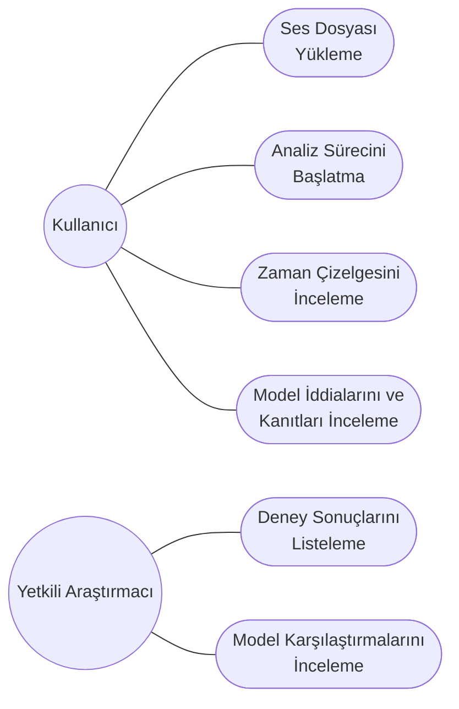
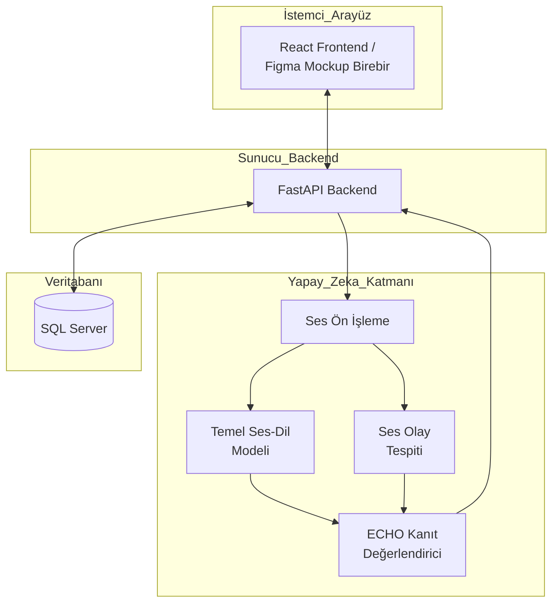
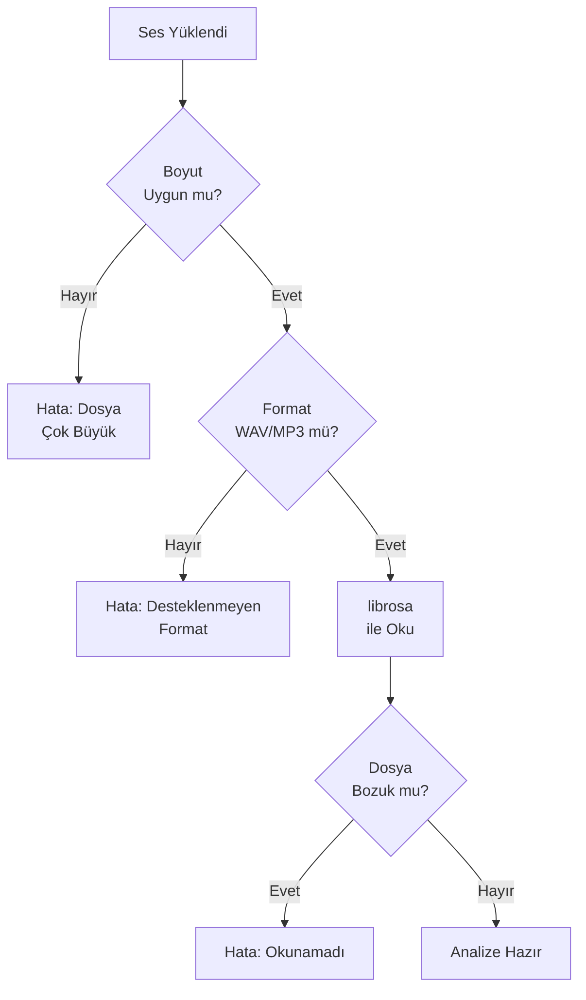
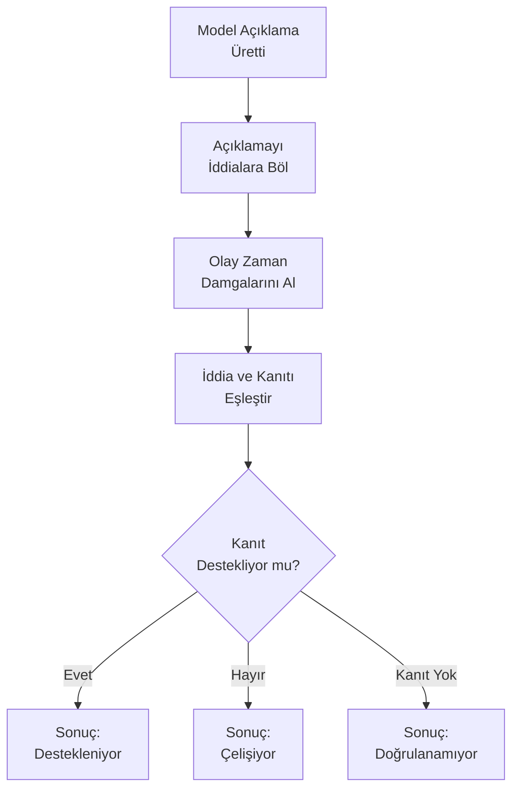
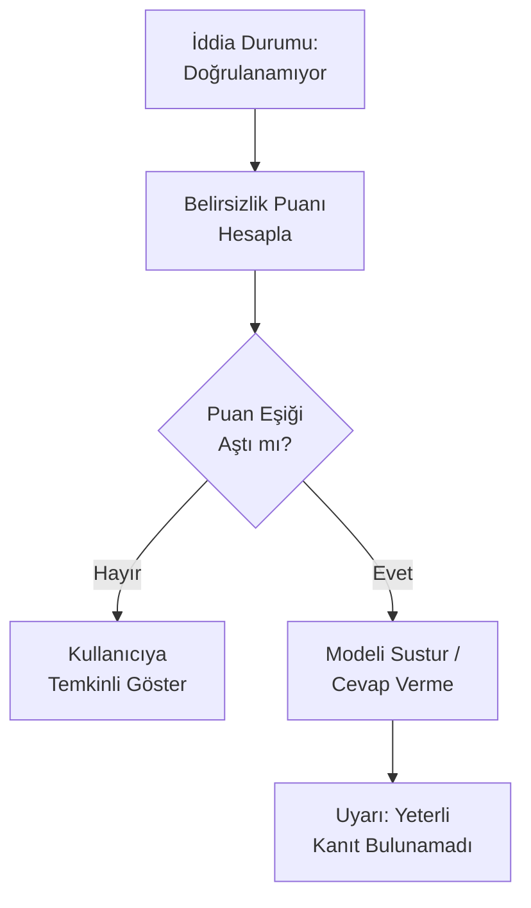
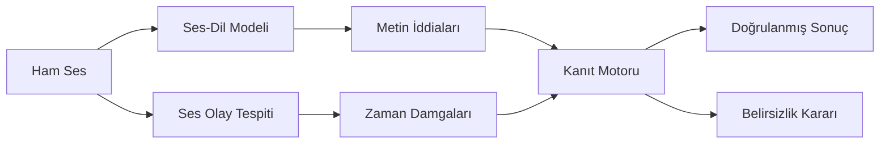

### 1. Kullanım Senaryosu (Use Case) Diyagramı

### 2. Sistem Mimarisi Diyagramı

### 3. Akış Diyagramları

**Akış 1: Ses Yükleme**

**Akış 2: ECHO Kanıt Eşleştirme**

**Akış 3: Belirsizlik Kararı**

### 4. AI Pipeline

