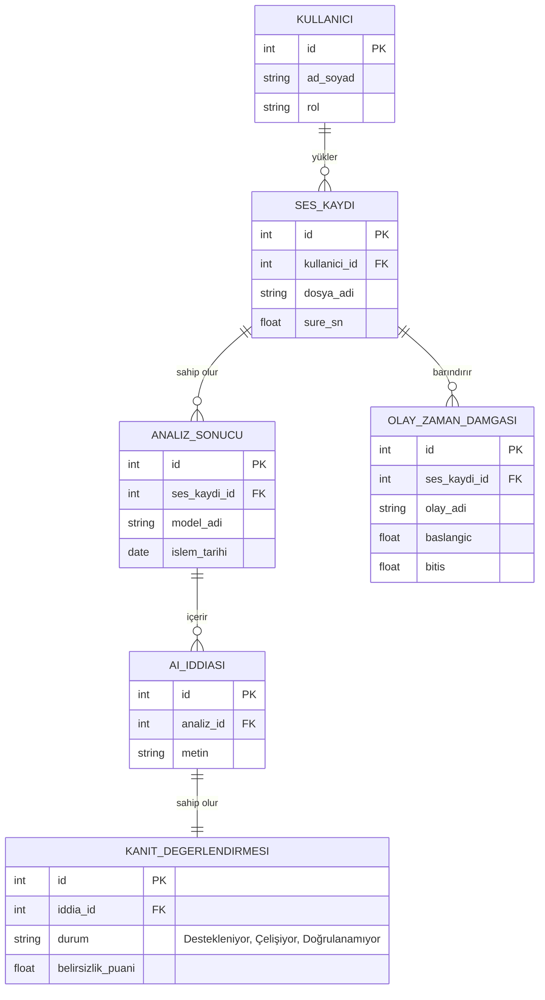

### 1. Veritabanı ER (Varlık-İlişki) Diyagramı

### 2. Veritabanı Şeması ve Veri Sözlüğü

| Tablo Adı | Sütun Adı | Veri Tipi | Kısıtlama | Açıklama |
| :--- | :--- | :--- | :--- | :--- |
| **Kullanıcılar** | id | INT | Primary Key | Kullanıcı benzersiz kimliği |
| | ad_soyad | VARCHAR(100) | Not Null | Kullanıcının tam adı |
| | rol | VARCHAR(20) | Not Null | Admin veya Standart kullanıcı |
| **Ses_Kayitlari**| id | INT | Primary Key | Yüklenen sesin benzersiz kimliği |
| | kullanici_id | INT | Foreign Key | Sesi yükleyen kullanıcı ID'si |
| | dosya_adi | VARCHAR(255) | Not Null | Orijinal dosya adı (ör. kopek_havlamasi.wav) |
| | sure_sn | FLOAT | Not Null | Saniyesi cinsinden ses uzunluğu |
| **Yapay_Zeka_Iddialari**| id | INT | Primary Key | Modelin ürettiği cümlenin kimliği |
| | metin | TEXT | Not Null | Cümle (ör: "Köpek havlıyor") |
| **Kanit_Degerlendirmeleri**| durum | VARCHAR(50) | Not Null | "Destekleniyor", "Çelişiyor", "Doğrulanamıyor" |
| | belirsizlik_puani| FLOAT | | 0 ile 1 arası model kararsızlık skoru |
| **Olay_Zaman_Damgalari**| olay_adi | VARCHAR(100) | Not Null | Saptanan olay (ör: "Kapı Sesi") |
| | baslangic | FLOAT | Not Null | Olayın başladığı saniye |
| | bitis | FLOAT | Not Null | Olayın bittiği saniye |

### 3. Teknoloji Yığını Tablosu

| Katman | Seçilen Teknoloji | Kullanım Amacı |
| :--- | :--- | :--- |
| **İşletim Sistemi / İstemci** | Windows / Web Tarayıcı | Geliştirme ortamı ve son kullanıcı arayüzü erişimi |
| **Frontend (Arayüz)** | React.js | Dinamik ve kullanıcı dostu web arayüzünün oluşturulması |
| **Backend (Sunucu)** | FastAPI (Python) | Hızlı API uç noktalarının oluşturulması ve model yönetimi |
| **Veritabanı** | SQL Server (MSSQL) | Kullanıcı, ses ve analiz verilerinin güvenli, ilişkisel saklanması |
| **Yapay Zeka (Ses İşleme)** | librosa, PyTorch | Ses dalgalarının işlenmesi, spektrogram dönüşümleri |
| **Yapay Zeka (Modeller)** | Qwen-Audio / YAMNet (Quantize) | 4 GB VRAM kısıtına uygun ses-dil açıklaması ve zaman tespiti |
| **Prototip ve Tasarım** | Figma | Geliştirme öncesi birebir piksel mock-up ekran tasarımı |
| **Versiyon Kontrol** | Git & GitHub | Kaynak kod yönetimi ve proje dokümantasyonu |
